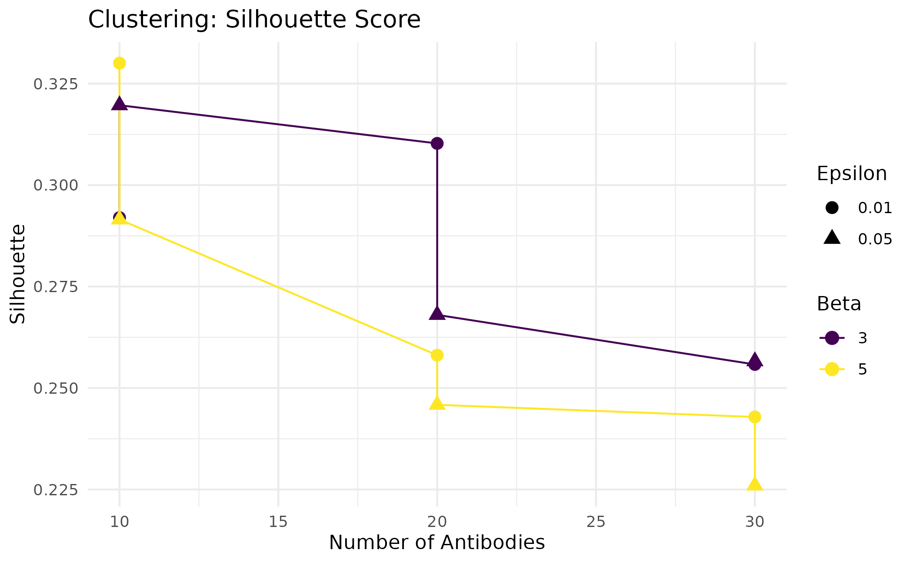
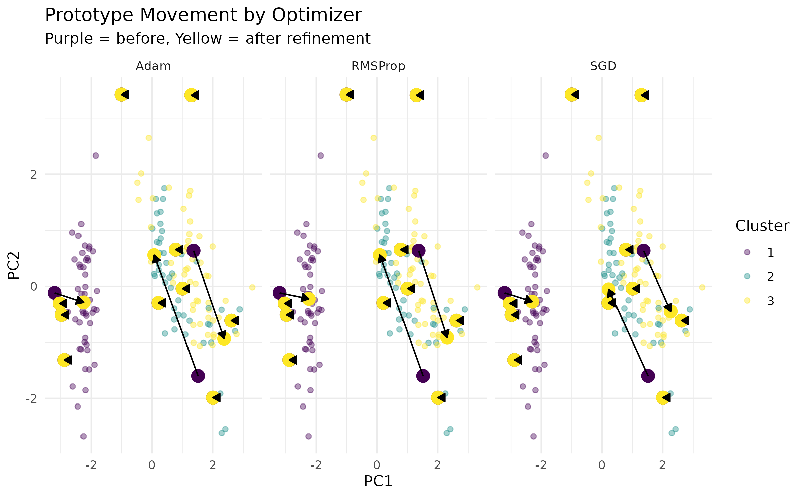
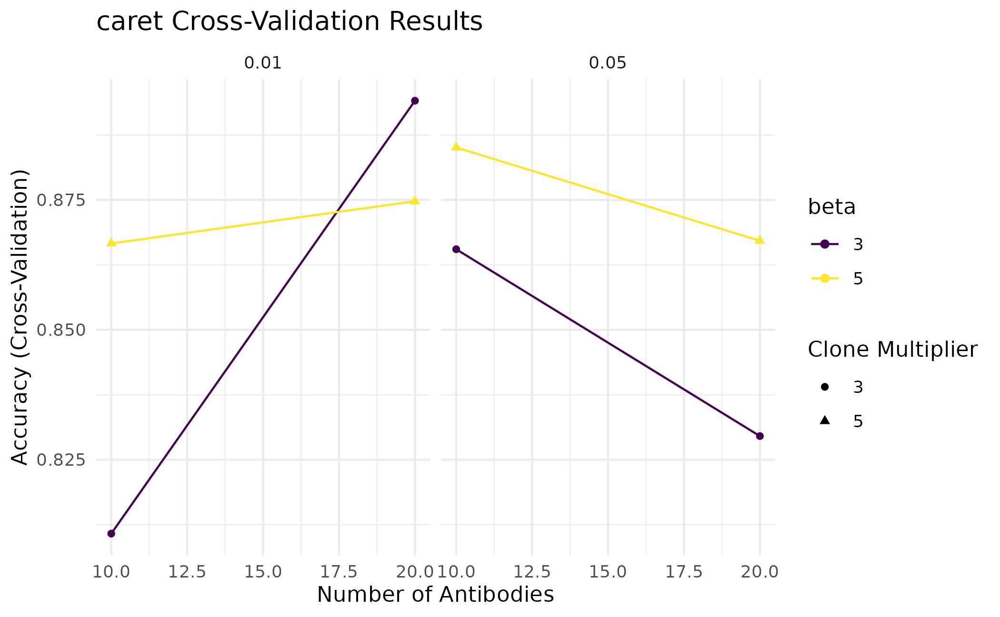
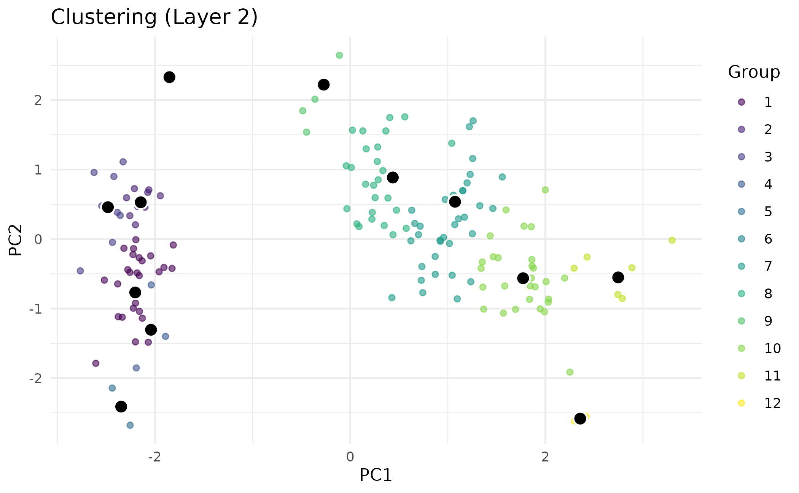
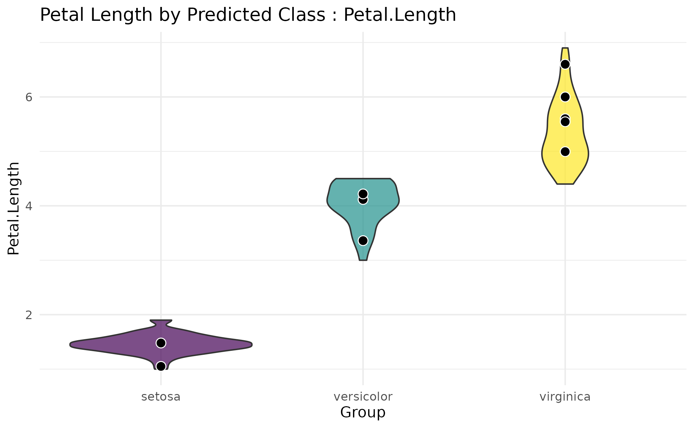

# Advanced Tuning & Workflows

    ## Warning: replacing previous import 'S4Arrays::makeNindexFromArrayViewport' by
    ## 'DelayedArray::makeNindexFromArrayViewport' when loading 'SummarizedExperiment'

## Introduction

This vignette covers advanced usage patterns for bHIVE:

1.  Hyperparameter tuning with
    [`swarmbHIVE()`](https://www.borch.dev/uploads/bhive/reference/swarmbHIVE.md)
    across tasks
2.  Multilayer hierarchical refinement with
    [`honeycombHIVE()`](https://www.borch.dev/uploads/bhive/reference/honeycombHIVE.md)
3.  Gradient-based prototype refinement with
    [`refineB()`](https://www.borch.dev/uploads/bhive/reference/refineB.md)
4.  Integration with the `caret` framework
5.  Visualization with
    [`visualizeHIVE()`](https://www.borch.dev/uploads/bhive/reference/visualizeHIVE.md)

## Hyperparameter Tuning with swarmbHIVE

[`swarmbHIVE()`](https://www.borch.dev/uploads/bhive/reference/swarmbHIVE.md)
performs grid search over bHIVE hyperparameters and evaluates each
combination using a task-specific metric.

### Available Metrics

| Task | Metrics | Direction |
|:---|:---|:---|
| Clustering | `"silhouette"`, `"davies_bouldin"`, `"calinski_harabasz"` | Higher is better (except D-B) |
| Classification | `"accuracy"`, `"balanced_accuracy"`, `"f1"`, `"kappa"` | Higher is better |

### Clustering Tuning

``` r

data(iris)
X <- as.matrix(iris[, 1:4])

grid <- expand.grid(
  nAntibodies = c(10, 20, 30),
  beta        = c(3, 5),
  epsilon     = c(0.01, 0.05)
)

set.seed(42)
tuning <- swarmbHIVE(X = X, task = "clustering", grid = grid,
                     metric = "silhouette", maxIter = 15, verbose = FALSE)

ggplot(tuning$results, aes(x = nAntibodies, y = metric_value,
                            color = factor(beta))) +
  geom_line() +
  geom_point(aes(shape = factor(epsilon)), size = 3) +
  labs(title = "Clustering: Silhouette Score",
       x = "Number of Antibodies", y = "Silhouette",
       color = "Beta", shape = "Epsilon") +
  scale_color_viridis_d() +
  theme_minimal()
```



``` r

tuning$best_params
```

    ##   nAntibodies beta epsilon metric_value
    ## 4          10    5    0.01    0.3300533

### Classification Tuning

``` r

y <- iris$Species
grid_cls <- expand.grid(
  nAntibodies = c(15, 30, 50),
  beta        = c(3, 5, 10),
  epsilon     = c(0.01, 0.05)
)

set.seed(42)
tuning_cls <- swarmbHIVE(X = X, y = y, task = "classification",
                         grid = grid_cls, metric = "accuracy",
                         maxIter = 15, verbose = FALSE)
tuning_cls$best_params
```

    ##   nAntibodies beta epsilon metric_value
    ## 3          50    3    0.01    0.9666667

### Parallelization with BiocParallel

[`swarmbHIVE()`](https://www.borch.dev/uploads/bhive/reference/swarmbHIVE.md)
accepts a `BPPARAM` argument for parallel execution. This is especially
useful when the grid is large:

``` r

library(BiocParallel)

# Use 4 cores
tuning <- swarmbHIVE(
  X = X, y = y, task = "classification",
  grid = grid_cls, metric = "accuracy",
  BPPARAM = MulticoreParam(4),
  verbose = FALSE
)
```

## Multilayer Refinement with honeycombHIVE

[`honeycombHIVE()`](https://www.borch.dev/uploads/bhive/reference/honeycombHIVE.md)
runs bHIVE iteratively across multiple layers. Each layer produces
prototypes that become the input for the next layer, creating a
hierarchical compression of the data.

### Basic Multilayer Clustering

``` r

set.seed(42)
res <- honeycombHIVE(X = X, task = "clustering",
                     layers = 3, nAntibodies = 30,
                     beta = 5, epsilon = 0.05,
                     maxIter = 10, verbose = FALSE)

# Each layer progressively refines cluster structure
layer_info <- sapply(res, function(r) {
  c(n_prototypes = nrow(r$antibodies),
    n_clusters = length(unique(r$membership)))
})
layer_info
```

    ##              [,1] [,2] [,3]
    ## n_prototypes   22    9    5
    ## n_clusters     22    9    5

### Collapse Methods

The `collapseMethod` parameter controls how clusters are summarized into
prototypes for the next layer:

| Method       | Description                         |
|:-------------|:------------------------------------|
| `"centroid"` | Mean of cluster members (default)   |
| `"medoid"`   | Actual data point closest to center |
| `"median"`   | Coordinate-wise median              |

``` r

set.seed(42)
res_centroid <- honeycombHIVE(X = X, task = "clustering", layers = 2,
                              nAntibodies = 20, collapseMethod = "centroid",
                              verbose = FALSE)
res_medoid <- honeycombHIVE(X = X, task = "clustering", layers = 2,
                            nAntibodies = 20, collapseMethod = "medoid",
                            verbose = FALSE)

cat("Centroid clusters:", length(unique(res_centroid[[2]]$membership)), "\n")
```

    ## Centroid clusters: 9

``` r

cat("Medoid clusters:  ", length(unique(res_medoid[[2]]$membership)), "\n")
```

    ## Medoid clusters:   11

### With Gradient Refinement

Setting `refine = TRUE` applies gradient-based updates via
[`refineB()`](https://www.borch.dev/uploads/bhive/reference/refineB.md)
after each layer’s bHIVE pass. This fine-tunes prototype positions
before collapsing.

``` r

data(iris)
X_iris <- as.matrix(iris[, 1:4])
y_iris <- iris$Species

set.seed(42)
res_plain <- honeycombHIVE(X = X_iris, y = y_iris, task = "classification",
                           layers = 3, nAntibodies = 30, verbose = FALSE)

res_refined <- honeycombHIVE(X = X_iris, y = y_iris, task = "classification",
                             layers = 3, nAntibodies = 30,
                             refine = TRUE, refineOptimizer = "adam",
                             refineLoss = "categorical_crossentropy",
                             refineSteps = 5, refineLR = 0.01, verbose = FALSE)

acc_plain   <- mean(res_plain[[3]]$predictions   == as.character(y_iris))
acc_refined <- mean(res_refined[[3]]$predictions == as.character(y_iris))
cat("Accuracy (plain):  ", round(acc_plain, 3), "\n")
```

    ## Accuracy (plain):   0.92

``` r

cat("Accuracy (refined):", round(acc_refined, 3), "\n")
```

    ## Accuracy (refined): 0.887

## Gradient Refinement with refineB

[`refineB()`](https://www.borch.dev/uploads/bhive/reference/refineB.md)
takes trained antibody positions and fine-tunes them using
gradient-based optimization. It supports 5 optimizers and 8 loss
functions.

### Optimizers

| Optimizer    | Key Parameter    | Notes                                 |
|:-------------|:-----------------|:--------------------------------------|
| `"sgd"`      | `lr`             | Simple, good baseline                 |
| `"momentum"` | `momentum_coef`  | Accelerates SGD                       |
| `"adagrad"`  | –                | Per-parameter adaptive learning rates |
| `"adam"`     | `beta1`, `beta2` | Best general-purpose optimizer        |
| `"rmsprop"`  | `rmsprop_decay`  | Good for non-stationary objectives    |

### Loss Functions

| Loss | Tasks | Description |
|:---|:---|:---|
| `"mae"` | All | Mean absolute error (sign-based pull/push) |
| `"categorical_crossentropy"` | Classification | Cross-entropy loss |
| `"binary_crossentropy"` | Classification | Binary cross-entropy |
| `"kullback_leibler"` | Classification | KL divergence |
| `"cosine"` | Classification | Cosine distance loss |

### Comparing Optimizers

``` r

X <- as.matrix(iris[, 1:4])
y <- iris$Species

set.seed(42)
res <- bHIVE(X, y, task = "classification", nAntibodies = 10,
             beta = 5, epsilon = 0.05, initMethod = "random",
             k = 4, verbose = FALSE)

Ab <- res$antibodies
colnames(Ab) <- colnames(X)
assignments <- as.integer(factor(res$assignments,
                                 levels = unique(res$assignments)))

pca <- prcomp(X, scale. = TRUE)
X_pca <- pca$x[, 1:2]
A_orig_pca <- predict(pca, Ab)

optimizers <- c("sgd", "adam", "rmsprop")
refined_list <- lapply(optimizers, function(opt) {
  Ab_refined <- refineB(A = Ab, X = X, y = y,
                        assignments = assignments,
                        task = "classification",
                        loss = "categorical_crossentropy",
                        optimizer = opt, steps = 5, lr = 0.01,
                        verbose = FALSE)
  colnames(Ab_refined) <- colnames(X)
  A_ref_pca <- predict(pca, Ab_refined)
  data.frame(optimizer = opt,
             PC1_after = A_ref_pca[, 1],
             PC2_after = A_ref_pca[, 2])
})

refined_df <- do.call(rbind, refined_list)
refined_df$ID <- factor(rep(seq_len(nrow(Ab)), times = length(optimizers)))

proto_df <- data.frame(ID = factor(seq_len(nrow(A_orig_pca))),
                       PC1_before = A_orig_pca[, 1],
                       PC2_before = A_orig_pca[, 2])

merged <- merge(proto_df, refined_df, by = "ID")

ggplot() +
  geom_point(data = data.frame(PC1 = X_pca[, 1], PC2 = X_pca[, 2],
                                Cluster = factor(assignments)),
             aes(x = PC1, y = PC2, color = Cluster), alpha = 0.4) +
  geom_point(data = proto_df,
             aes(x = PC1_before, y = PC2_before),
             color = "#440154", size = 4) +
  geom_point(data = merged,
             aes(x = PC1_after, y = PC2_after),
             color = "#FDE725", size = 4) +
  geom_segment(data = merged,
               aes(x = PC1_before, y = PC2_before,
                   xend = PC1_after, yend = PC2_after),
               arrow = arrow(length = unit(0.2, "cm"), type = "closed"),
               color = "black", linewidth = 0.5) +
  scale_color_viridis_d() +
  labs(title = "Prototype Movement by Optimizer",
       subtitle = "Purple = before, Yellow = after refinement",
       x = "PC1", y = "PC2") +
  facet_wrap(~optimizer, nrow = 1,
             labeller = as_labeller(c(sgd = "SGD", adam = "Adam",
                                      rmsprop = "RMSProp"))) +
  theme_minimal()
```



## caret Integration

bHIVE provides two caret-compatible model objects for use with
[`train()`](https://rdrr.io/pkg/caret/man/train.html):

- `bHIVEmodel` – single-pass bHIVE with tuning over `nAntibodies`,
  `beta`, and `epsilon`
- `honeycombHIVEmodel` – multilayer bHIVE with additional tuning over
  `layers`, `refineOptimizer`, `refineSteps`, and `refineLR`

### Basic caret Workflow

``` r

library(caret)

data(iris)
X_iris <- as.matrix(iris[, 1:4])
y_iris <- iris$Species

set.seed(42)
idx <- sample(nrow(X_iris), nrow(X_iris) * 0.7)
X_train <- X_iris[idx, ]
X_test  <- X_iris[-idx, ]
y_train <- y_iris[idx]
y_test  <- y_iris[-idx]

ctrl <- trainControl(method = "cv", number = 3)

model <- train(
  x = X_train, y = y_train,
  method = bHIVEmodel,
  trControl = ctrl,
  tuneGrid = expand.grid(
    nAntibodies = c(10, 20),
    beta        = c(3, 5),
    epsilon     = c(0.01, 0.05)
  ),
  verbose = FALSE
)

ggplot(model) +
  labs(title = "caret Cross-Validation Results") +
  scale_color_viridis_d() +
  theme_minimal()
```

    ## Warning: `aes_string()` was deprecated in ggplot2 3.0.0.
    ## ℹ Please use tidy evaluation idioms with `aes()`.
    ## ℹ See also `vignette("ggplot2-in-packages")` for more information.
    ## ℹ The deprecated feature was likely used in the caret package.
    ##   Please report the issue at <https://github.com/topepo/caret/issues>.
    ## This warning is displayed once per session.
    ## Call `lifecycle::last_lifecycle_warnings()` to see where this warning was
    ## generated.



### Prediction on Held-Out Data

``` r

preds <- predict(model, newdata = X_test)
table(Predicted = preds, Actual = y_test)
```

    ##             Actual
    ## Predicted    setosa versicolor virginica
    ##   setosa         12          0         0
    ##   versicolor      0         14         7
    ##   virginica       0          1        11

### honeycombHIVE caret Model

The multilayer caret model adds layer count and refinement parameters to
the tuning grid:

``` r

model_hc <- train(
  x = X_train, y = y_train,
  method = honeycombHIVEmodel,
  trControl = trainControl(method = "cv", number = 3),
  tuneGrid = expand.grid(
    nAntibodies = c(20, 30),
    beta        = 5,
    epsilon     = 0.05,
    layers      = c(2, 3),
    refineOptimizer = "adam",
    refineSteps     = 5,
    refineLR        = 0.01
  ),
  verbose = FALSE
)
model_hc$results[, c("nAntibodies", "layers", "Accuracy", "Kappa")]
```

    ##   nAntibodies layers  Accuracy     Kappa
    ## 1          20      2 0.8947811 0.8412631
    ## 2          20      3 0.8552189 0.7820403
    ## 3          30      2 0.9141414 0.8705741
    ## 4          30      3 0.8543771 0.7807799

## Visualization with visualizeHIVE

The
[`visualizeHIVE()`](https://www.borch.dev/uploads/bhive/reference/visualizeHIVE.md)
function produces publication-ready ggplot2 figures for bHIVE and
honeycombHIVE results.

### Plot Types

| Type | Description |
|:---|:---|
| `"scatter"` | 2D scatter with optional dimensionality reduction (PCA, UMAP, t-SNE) |
| `"boxplot"` | Feature distributions by group with prototype overlay |
| `"violin"` | Violin plots with prototype markers |
| `"density"` | Density curves with prototype reference lines |

### Scatter Plot with PCA

``` r

X <- as.matrix(iris[, 1:4])

set.seed(42)
res <- honeycombHIVE(X = X, task = "clustering", layers = 3,
                     nAntibodies = 30, beta = 5, epsilon = 0.05,
                     maxIter = 10, verbose = FALSE)

visualizeHIVE(result = res, X = iris[, 1:4],
              plot_type = "scatter",
              transformation_method = "PCA",
              title = "Clustering (Layer 2)",
              layer = 2, task = "clustering")
```



### Violin Plot for Classification

``` r

set.seed(42)
res_cls <- honeycombHIVE(X = X, y = iris$Species,
                         task = "classification",
                         layers = 2, nAntibodies = 15,
                         beta = 5, maxIter = 10, verbose = FALSE)

visualizeHIVE(result = res_cls, X = iris[, 1:4],
              plot_type = "violin", feature = "Petal.Length",
              title = "Petal Length by Predicted Class",
              layer = 1, task = "classification")
```



## Combining Modules with honeycombHIVE

The R6 API with modules and the functional
[`honeycombHIVE()`](https://www.borch.dev/uploads/bhive/reference/honeycombHIVE.md)
API serve different use cases. For maximum control, use `AINet` directly
with modules for single-pass analysis. For hierarchical refinement, use
[`honeycombHIVE()`](https://www.borch.dev/uploads/bhive/reference/honeycombHIVE.md)
with its built-in layer management and gradient refinement.

A typical advanced workflow:

1.  **Explore** with
    [`bHIVE()`](https://www.borch.dev/uploads/bhive/reference/bHIVE.md)
    to establish baseline performance
2.  **Tune** with
    [`swarmbHIVE()`](https://www.borch.dev/uploads/bhive/reference/swarmbHIVE.md)
    to find good hyperparameters
3.  **Compose** modules via `AINet` to add biological mechanisms
4.  **Layer** with
    [`honeycombHIVE()`](https://www.borch.dev/uploads/bhive/reference/honeycombHIVE.md)
    for hierarchical refinement
5.  **Visualize** with
    [`visualizeHIVE()`](https://www.borch.dev/uploads/bhive/reference/visualizeHIVE.md)
    to understand results

``` r

sessionInfo()
```

    ## R version 4.6.1 (2026-06-24)
    ## Platform: x86_64-pc-linux-gnu
    ## Running under: Ubuntu 24.04.5 LTS
    ## 
    ## Matrix products: default
    ## BLAS:   /usr/lib/x86_64-linux-gnu/openblas-pthread/libblas.so.3 
    ## LAPACK: /usr/lib/x86_64-linux-gnu/openblas-pthread/libopenblasp-r0.3.26.so;  LAPACK version 3.12.0
    ## 
    ## locale:
    ##  [1] LC_CTYPE=C.UTF-8       LC_NUMERIC=C           LC_TIME=C.UTF-8       
    ##  [4] LC_COLLATE=C.UTF-8     LC_MONETARY=C.UTF-8    LC_MESSAGES=C.UTF-8   
    ##  [7] LC_PAPER=C.UTF-8       LC_NAME=C              LC_ADDRESS=C          
    ## [10] LC_TELEPHONE=C         LC_MEASUREMENT=C.UTF-8 LC_IDENTIFICATION=C   
    ## 
    ## time zone: UTC
    ## tzcode source: system (glibc)
    ## 
    ## attached base packages:
    ## [1] stats     graphics  grDevices utils     datasets  methods   base     
    ## 
    ## other attached packages:
    ## [1] caret_7.0-1      lattice_0.22-9   ggplot2_4.0.3    bHIVE_0.99.8    
    ## [5] BiocStyle_2.40.0
    ## 
    ## loaded via a namespace (and not attached):
    ##   [1] pROC_1.19.1                 rlang_1.3.0                
    ##   [3] magrittr_2.0.5              otel_0.2.0                 
    ##   [5] e1071_1.7-17                matrixStats_1.5.0          
    ##   [7] compiler_4.6.1              systemfonts_1.3.2          
    ##   [9] vctrs_0.7.3                 reshape2_1.4.5             
    ##  [11] stringr_1.6.0               pkgconfig_2.0.3            
    ##  [13] fastmap_1.2.0               XVector_0.52.0             
    ##  [15] labeling_0.4.3              rmarkdown_2.32             
    ##  [17] prodlim_2026.03.11          ragg_1.5.2                 
    ##  [19] purrr_1.2.2                 xfun_0.61                  
    ##  [21] bluster_1.22.0              cachem_1.1.0               
    ##  [23] jsonlite_2.0.0              recipes_1.4.0              
    ##  [25] DelayedArray_0.38.2         BiocParallel_1.46.0        
    ##  [27] clusterCrit_1.3.0           parallel_4.6.1             
    ##  [29] cluster_2.1.8.2             R6_2.6.1                   
    ##  [31] bslib_0.12.0                stringi_1.8.9              
    ##  [33] RColorBrewer_1.1-3          parallelly_1.48.0          
    ##  [35] rpart_4.1.27                GenomicRanges_1.64.0       
    ##  [37] lubridate_1.9.5             jquerylib_0.1.4            
    ##  [39] Rcpp_1.1.2                  Seqinfo_1.2.0              
    ##  [41] bookdown_0.48               SummarizedExperiment_1.42.0
    ##  [43] iterators_1.0.14            knitr_1.52                 
    ##  [45] future.apply_1.20.2         IRanges_2.46.0             
    ##  [47] Matrix_1.7-5                splines_4.6.1              
    ##  [49] nnet_7.3-20                 igraph_2.3.4               
    ##  [51] timechange_0.4.0            tidyselect_1.2.1           
    ##  [53] abind_1.4-8                 yaml_2.3.12                
    ##  [55] timeDate_4052.112           codetools_0.2-20           
    ##  [57] listenv_1.1.0               tibble_3.3.1               
    ##  [59] plyr_1.8.9                  Biobase_2.72.0             
    ##  [61] withr_3.0.3                 S7_0.2.2                   
    ##  [63] evaluate_1.0.5              future_1.80.0              
    ##  [65] desc_1.4.3                  survival_3.8-6             
    ##  [67] proxy_0.4-29                pillar_1.11.1              
    ##  [69] BiocManager_1.30.27         MatrixGenerics_1.24.0      
    ##  [71] foreach_1.5.2               stats4_4.6.1               
    ##  [73] generics_0.1.4              S4Vectors_0.50.3           
    ##  [75] scales_1.4.0                globals_0.20.0             
    ##  [77] class_7.3-23                glue_1.8.1                 
    ##  [79] tools_4.6.1                 BiocNeighbors_2.6.0        
    ##  [81] data.table_1.18.6.1         ModelMetrics_1.2.2.2       
    ##  [83] gower_1.0.2                 fs_2.1.0                   
    ##  [85] grid_4.6.1                  ipred_0.9-16               
    ##  [87] SingleCellExperiment_1.34.0 nlme_3.1-169               
    ##  [89] cli_3.6.6                   textshaping_1.0.5          
    ##  [91] S4Arrays_1.12.1             viridisLite_0.4.3          
    ##  [93] lava_1.9.3                  dplyr_1.2.1                
    ##  [95] gtable_0.3.6                sass_0.4.10                
    ##  [97] digest_0.6.39               BiocGenerics_0.58.1        
    ##  [99] SparseArray_1.12.3          farver_2.1.2               
    ## [101] htmltools_0.5.9             pkgdown_2.2.1              
    ## [103] lifecycle_1.0.5             hardhat_1.4.3              
    ## [105] MASS_7.3-65
