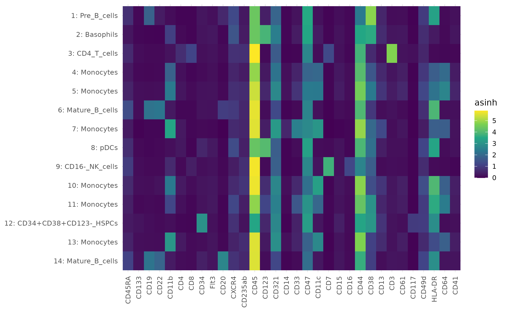
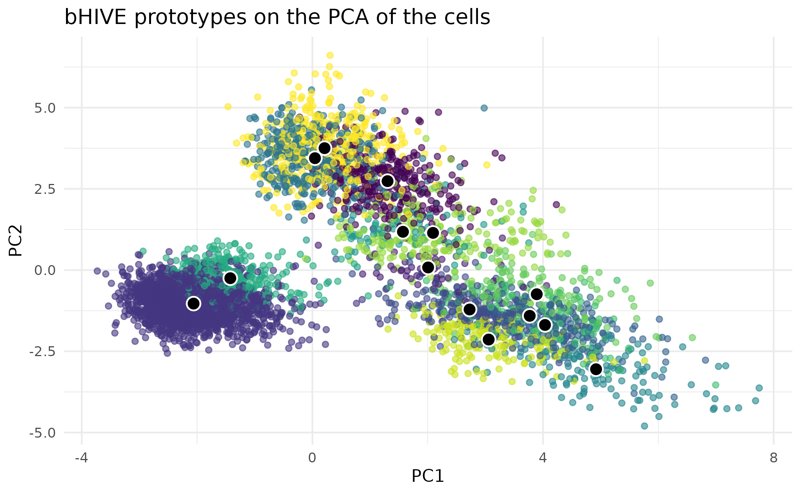
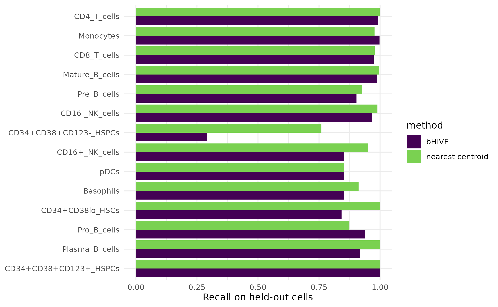

# Immune-inspired prototypes for cytometry and single-cell data with bHIVE

## Introduction

Cytometry and single-cell RNA-seq measure many markers on many cells.
Two questions come up in almost every analysis. Which cell populations
are present? And which population does a new cell belong to? Clustering
answers the first. Classification, or label transfer from an annotated
reference, answers the second.

*[bHIVE](https://bioconductor.org/packages/3.23/bHIVE)* answers both
with one model, an artificial immune network. A set of prototypes,
called antibodies, evolves the way B cells do in an immune response.
Antibodies that bind the data well are cloned, the clones mutate, and
near-duplicates are suppressed. What remains is a small set of points in
marker space that summarize the cells.

What this gives an analyst:

- **Prototypes you can read.** Each antibody is a point in the original
  marker units, so a heatmap of the antibodies reads like a table of
  population phenotypes.
- **One model for clustering and label transfer.** The same fitted
  object that clusters a sample can label new cells with `$predict()`.
- **Rare populations.** In supervised mode every class is seeded with
  its own antibodies, so a population of a few cells is not lost. In
  unsupervised mode `coverageBoost` seeds antibodies where coverage is
  poor.
- **A cluster count you choose or let emerge.** By default the number of
  clusters comes out of the suppression dynamics. Set `targetK` to fix
  it.
- **Composable immune modules.** The R6 engine, `AINet`, accepts modules
  for somatic hypermutation, germinal center selection, microenvironment
  and more. The second vignette,
  [`vignette("immune-modules", package = "bHIVE")`](https://www.borch.dev/uploads/bhive/articles/immune-modules.md),
  covers them.

bHIVE works with Bioconductor data structures.
[`bHIVE()`](https://www.borch.dev/uploads/bhive/reference/bHIVE.md)
accepts a `SummarizedExperiment` or `SingleCellExperiment` and stores
its labels in
[`colData()`](https://rdrr.io/pkg/SummarizedExperiment/man/SummarizedExperiment-class.html).
[`bHIVEParam()`](https://www.borch.dev/uploads/bhive/reference/bHIVEParam.md)
plugs bHIVE into
*[bluster](https://bioconductor.org/packages/3.23/bluster)*, so it also
runs through
[`bluster::clusterRows()`](https://rdrr.io/pkg/bluster/man/clusterRows.html)
and
[`bluster::clusterSweep()`](https://rdrr.io/pkg/bluster/man/clusterSweep.html).

bHIVE does not replace graph-based clustering or
*[FlowSOM](https://bioconductor.org/packages/3.23/FlowSOM)*. The
comparison below shows that a shared-nearest-neighbor graph recovers
manually gated populations better on this dataset. bHIVE is a prototype
model to inspect and reuse.

## Installation

``` r

if (!requireNamespace("BiocManager", quietly = TRUE))
    install.packages("BiocManager")
BiocManager::install("bHIVE")
```

## A mass cytometry dataset

We use bone marrow mass cytometry data from Levine et al. (2015),
available through
*[HDCytoData](https://bioconductor.org/packages/3.23/HDCytoData)*. Each
cell was gated by hand into one of 14 populations or left unassigned.
The gates give a reference to score clusterings against.

HDCytoData stores cells in rows and markers in columns. Bioconductor
single-cell containers use the opposite orientation, so we transpose. We
keep the 32 lineage markers, take 5,000 gated cells, and apply the usual
`asinh(x / 5)` transform for mass cytometry.

``` r

library(bHIVE)
```

    ## Warning: replacing previous import 'S4Arrays::makeNindexFromArrayViewport' by
    ## 'DelayedArray::makeNindexFromArrayViewport' when loading 'SummarizedExperiment'

``` r

library(SingleCellExperiment)
library(HDCytoData)
library(bluster)
library(ggplot2)

se <- Levine_32dim_SE()
```

``` r

type_markers <- colData(se)$marker_class == "type"
gated <- which(rowData(se)$population_id != "unassigned")

set.seed(1)
keep <- sample(gated, 5000)
sce <- SingleCellExperiment(
    assays = list(exprs = t(asinh(assay(se, "exprs")[keep, type_markers] / 5))),
    colData = droplevels(rowData(se)[keep, ]))
colnames(sce) <- paste0("cell", seq_len(ncol(sce)))
sce
```

    ## class: SingleCellExperiment 
    ## dim: 32 5000 
    ## metadata(0):
    ## assays(1): exprs
    ## rownames(32): CD45RA CD133 ... CD64 CD41
    ## rowData names(0):
    ## colnames(5000): cell1 cell2 ... cell4999 cell5000
    ## colData names(2): patient_id population_id
    ## reducedDimNames(0):
    ## mainExpName: NULL
    ## altExpNames(0):

``` r

sort(table(sce$population_id), decreasing = TRUE)
```

    ## 
    ##            CD4_T_cells              Monocytes            CD8_T_cells 
    ##                   1275                   1022                    936 
    ##         Mature_B_cells            Pre_B_cells         CD16-_NK_cells 
    ##                    780                    302                    187 
    ## CD34+CD38+CD123-_HSPCs         CD16+_NK_cells                   pDCs 
    ##                    166                    109                     71 
    ##              Basophils       CD34+CD38lo_HSCs            Pro_B_cells 
    ##                     59                     34                     25 
    ##         Plasma_B_cells CD34+CD38+CD123+_HSPCs 
    ##                     20                     14

The smallest populations have only a few dozen cells in this sample.

## Clustering a SingleCellExperiment

[`bHIVE()`](https://www.borch.dev/uploads/bhive/reference/bHIVE.md)
clusters the cells (the columns) of a `SingleCellExperiment` using an
assay, here `exprs`, or a
[`reducedDim()`](https://rdrr.io/pkg/SingleCellExperiment/man/reducedDims.html)
embedding through `use.dimred`. For scRNA-seq, cluster a PCA embedding
rather than a sparse assay.

Two settings matter for high-dimensional data.
`affinityParams = list(alpha = "auto")` sets the bandwidth of the
Gaussian affinity from the data. A fixed bandwidth of 1 makes almost
every affinity zero in 32 dimensions. `targetK` asks for a fixed number
of clusters, here the 14 gated populations.

``` r

set.seed(42)
sce <- bHIVE(sce, assay.type = "exprs", targetK = 14,
             affinityParams = list(alpha = "auto"),
             maxIter = 20, verbose = FALSE)
table(sce$bHIVE)
```

    ## 
    ##    1    2    3    4    5    6    7    8    9   10   11   12   13   14 
    ##  332   57 2211  197  242  391  134   83  296  123  143  214  183  394

``` r

ari_42 <- pairwiseRand(sce$population_id, sce$bHIVE, mode = "index")
ari_42
```

    ## [1] 0.5428569

The labels are in `colData(sce)$bHIVE`. The full result, including the
fitted model, is in `metadata(sce)$bHIVE`. The last line is the adjusted
Rand index (ARI) against the manual gates. An ARI of 1 means perfect
agreement, and 0 means chance. This run reaches 0.54. The comparison
below shows how much that changes with the random seed.

### Reading the prototypes

Each cluster has one prototype in marker space. A heatmap of the
prototypes shows each cluster’s phenotype. We label each cluster with
the gated population most of its cells came from.

``` r

res <- metadata(sce)$bHIVE
protos <- res$antibodies_unscaled
majority <- tapply(as.character(sce$population_id), sce$bHIVE,
                   function(p) names(which.max(table(p))))
rownames(protos) <- paste0(seq_len(nrow(protos)), ": ", majority)

long <- data.frame(
    cluster = factor(rep(rownames(protos), ncol(protos)),
                     levels = rev(rownames(protos))),
    marker  = factor(rep(colnames(protos), each = nrow(protos)),
                     levels = colnames(protos)),
    value   = as.vector(protos))
ggplot(long, aes(marker, cluster, fill = value)) +
    geom_tile() +
    scale_fill_viridis_c(name = "asinh") +
    labs(x = NULL, y = NULL) +
    theme_minimal() +
    theme(axis.text.x = element_text(angle = 90, hjust = 1, vjust = 0.5))
```



Reading the rows shows what a run separates and what it merges. A
population on more than one row was split. This run splits
Mature_B_cells, Monocytes. A population with no row of its own was
merged into its neighbors. Here that is CD16+\_NK_cells,
CD34+CD38+CD123+\_HSPCs, CD34+CD38lo_HSCs, CD8_T_cells, Plasma_B_cells,
Pro_B_cells. That explains most of the gap between this run and the
gates.

### Plotting the cells with their prototypes

[`visualizeHIVE()`](https://www.borch.dev/uploads/bhive/reference/visualizeHIVE.md)
fits a PCA to the cells and projects the prototypes into the same
coordinates.

``` r

X <- t(assay(sce, "exprs"))
visualizeHIVE(res, X = X, title = "bHIVE prototypes on the PCA of the cells")
```



## bHIVE through bluster

[`bHIVEParam()`](https://www.borch.dev/uploads/bhive/reference/bHIVEParam.md)
describes a bHIVE run for
*[bluster](https://bioconductor.org/packages/3.23/bluster)*. It works
anywhere a `BlusterParam` does.

``` r

param <- bHIVEParam(targetK = 14, affinityParams = list(alpha = "auto"),
                    maxIter = 20)
param
```

    ## class: bHIVEParam
    ## nAntibodies: [default]
    ## beta: [default]
    ## epsilon: [default]
    ## maxIter: 20
    ## k: [default]
    ## affinityFunc: [default]
    ## distFunc: [default]
    ## initMethod: [default]
    ## scale: [default]
    ## targetK: 14
    ## epsilonQuantile: [default]
    ## affinityParams(1): alpha
    ## extra(0):

``` r

set.seed(42)
clusters <- clusterRows(X, param)
table(clusters)
```

    ## clusters
    ##    1    2    3    4    5    6    7    8    9   10   11   12   13   14 
    ##  332   57 2211  197  242  391  134   83  296  123  143  214  183  394

The rows of `X` are the cells of `sce`, so the labels go straight into
[`colData()`](https://rdrr.io/pkg/SummarizedExperiment/man/SummarizedExperiment-class.html).

``` r

colLabels(sce) <- clusters
nlevels(colLabels(sce))
```

    ## [1] 14

[`bluster::clusterSweep()`](https://rdrr.io/pkg/bluster/man/clusterSweep.html)
varies any setting of the parameter object. Here it tries three cluster
counts.

``` r

set.seed(42)
sweep <- clusterSweep(X, bHIVEParam(affinityParams = list(alpha = "auto"),
                                    maxIter = 10),
                      targetK = c(8, 14, 20))
vapply(as.list(sweep$clusters),
       function(cl) pairwiseRand(sce$population_id, cl, mode = "index"),
       numeric(1))
```

    ##  targetK.8 targetK.14 targetK.20 
    ##  0.6942679  0.5563781  0.8458816

## Comparison with FlowSOM and bluster methods

We compare bHIVE with three methods used for cytometry and single-cell
data:

- *[FlowSOM](https://bioconductor.org/packages/3.23/FlowSOM)* builds a
  self-organizing map and merges its nodes into metaclusters. It is the
  standard prototype method for cytometry. We ask for 14 metaclusters.
- k-means with 14 centers, through
  [`bluster::KmeansParam()`](https://rdrr.io/pkg/bluster/man/KmeansParam-class.html).
- A shared-nearest-neighbor graph with Louvain community detection,
  through
  [`bluster::SNNGraphParam()`](https://rdrr.io/pkg/bluster/man/NNGraphParam-class.html).
  This is the usual default for single-cell data. It picks its own
  number of clusters.

bHIVE depends on its random seed, so we run it three times.

``` r

truth <- sce$population_id
timed <- function(expr) {
    start <- proc.time()[["elapsed"]]
    clusters <- expr
    list(clusters = clusters, seconds = proc.time()[["elapsed"]] - start)
}
runs <- list(
    "bHIVE, seed 1" = timed({ set.seed(1); clusterRows(X, param) }),
    "bHIVE, seed 2" = timed({ set.seed(2); clusterRows(X, param) }),
    "bHIVE, seed 3" = timed({ set.seed(3); clusterRows(X, param) }),
    "FlowSOM" = timed(FlowSOM::GetMetaclusters(FlowSOM::FlowSOM(
        X, compensate = FALSE, transform = FALSE, scale = FALSE,
        colsToUse = seq_len(ncol(X)), nClus = 14, seed = 1))),
    "k-means" = timed({ set.seed(1); clusterRows(X, KmeansParam(centers = 14)) }),
    "SNN graph + Louvain" = timed(clusterRows(
        X, SNNGraphParam(k = 15, cluster.fun = "louvain"))))

comparison <- data.frame(
    method   = names(runs),
    clusters = vapply(runs, function(r) length(unique(r$clusters)), integer(1)),
    ARI      = vapply(runs, function(r)
        pairwiseRand(truth, r$clusters, mode = "index"), numeric(1)),
    seconds  = vapply(runs, `[[`, numeric(1), "seconds"),
    row.names = NULL)
knitr::kable(comparison, digits = c(0, 0, 3, 1))
```

| method              | clusters |   ARI | seconds |
|:--------------------|---------:|------:|--------:|
| bHIVE, seed 1       |       14 | 0.805 |     1.7 |
| bHIVE, seed 2       |       14 | 0.869 |     1.7 |
| bHIVE, seed 3       |       14 | 0.967 |     1.8 |
| FlowSOM             |       14 | 0.897 |     6.2 |
| k-means             |       14 | 0.583 |     0.0 |
| SNN graph + Louvain |        8 | 0.971 |     0.8 |

The graph-based method reaches an ARI of 0.97 with only 8 clusters. ARI
is dominated by the large populations, so merging a few small ones costs
little. FlowSOM reaches 0.90 and k-means 0.58. Across the three seeds
here and the run above, bHIVE ranges from 0.54 to 0.97. A single bHIVE
run can match the graph method or fall well below FlowSOM.

That seed dependence is the main practical difference. If the goal is
one stable partition of a dataset, FlowSOM or a graph-based method is
the safer choice. With bHIVE, run several seeds and compare them, for
example with
[`bluster::pairwiseRand()`](https://rdrr.io/pkg/bluster/man/pairwiseRand.html).
The `ConvergentSelector` module keeps the antibodies that recur across
runs.

FlowSOM also builds prototypes, its map nodes, and can map new samples
onto them. So prototypes alone are not what sets bHIVE apart. The
differences are how bHIVE learns them, by selection, mutation and
suppression rather than on a fixed grid, and that the same model also
learns from labels. The next section shows that.

## Label transfer to new cells

Label transfer trains a classifier on annotated cells and applies it to
new ones. We train bHIVE on half of the gated cells and predict the
other half. For classification, bHIVE seeds every class with at least
`minPerClass` antibodies (default 5), so rare populations get their own
antibodies.

``` r

set.seed(2)
train <- sample(ncol(sce), ncol(sce) / 2)
test <- setdiff(seq_len(ncol(sce)), train)

set.seed(3)
ref <- bHIVE(sce[, train], y = "population_id", assay.type = "exprs",
             nAntibodies = 150, maxIter = 20, verbose = FALSE)
model <- metadata(ref)$bHIVE$model
predicted <- model$predict(X[test, ])
```

As a baseline we use the nearest class centroid. Each population is one
mean vector, and each test cell takes the label of the closest mean.

``` r

centroids <- apply(X[train, ], 2, function(v) tapply(v, truth[train], mean))
dist2 <- vapply(seq_len(nrow(centroids)), function(j)
    colSums((t(X[test, ]) - centroids[j, ])^2), numeric(length(test)))
baseline <- rownames(centroids)[max.col(-dist2)]

score <- function(p) {
    hit <- p == truth[test]
    c(accuracy = mean(hit), balanced_accuracy = mean(tapply(hit, truth[test], mean)))
}
knitr::kable(rbind(bHIVE = score(predicted),
                   "nearest centroid" = score(baseline)), digits = 3)
```

|                  | accuracy | balanced_accuracy |
|:-----------------|---------:|------------------:|
| bHIVE            |    0.952 |             0.884 |
| nearest centroid |    0.973 |             0.944 |

Balanced accuracy averages the recall of each population, so rare
populations count as much as common ones.

``` r

recall <- function(p) tapply(p == truth[test], truth[test], mean)
per_pop <- data.frame(
    population = rep(levels(truth), 2),
    method = rep(c("bHIVE", "nearest centroid"), each = nlevels(truth)),
    recall = c(recall(predicted), recall(baseline)))
per_pop$population <- factor(per_pop$population,
                             levels = names(sort(table(truth))))
ggplot(per_pop, aes(population, recall, fill = method)) +
    geom_col(position = "dodge") +
    coord_flip() +
    scale_fill_viridis_d(end = 0.8) +
    labs(x = NULL, y = "Recall on held-out cells") +
    theme_minimal()
```



The nearest-centroid baseline beats bHIVE here. Its accuracy is 0.97
against 0.95, and its balanced accuracy 0.94 against 0.88. It matches or
beats bHIVE on 12 of 14 populations. bHIVE’s per-class seeding keeps
every population represented, and its lowest recall is 0.29 for
CD34+CD38+CD123-\_HSPCs.

The gated populations in this dataset are compact and well separated in
marker space, so one mean per population is enough. bHIVE spends several
antibodies on each population. That helps when a population is spread
out or has more than one mode, which is not the case here. For label
transfer on data like these, a simple centroid classifier is the better
choice.

The fitted model can label any cells measured on the same panel. The
cells the original analysis left unassigned are one example.

``` r

unassigned <- which(rowData(se)$population_id == "unassigned")
set.seed(4)
new_cells <- asinh(assay(se, "exprs")[sample(unassigned, 2000),
                                      type_markers] / 5)
head(sort(table(model$predict(new_cells)), decreasing = TRUE))
```

    ## 
    ##    CD4_T_cells      Monocytes    CD8_T_cells Mature_B_cells    Pre_B_cells 
    ##            514            458            338            258            119 
    ## CD16-_NK_cells 
    ##             95

These cells were not gated by hand, so these labels have no reference to
check them against. Treat them as hypotheses to check against the
markers.

## The R6 engine and immune modules

[`bHIVE()`](https://www.borch.dev/uploads/bhive/reference/bHIVE.md) is a
thin wrapper over the R6 class `AINet`. Using `AINet` directly gives a
reusable model object and access to the immune modules. Here
`coverageBoost` adds antibodies where the data are covered worst, before
the 14 clusters are formed.

``` r

net <- AINet$new(nAntibodies = 40, maxIter = 15, targetK = 14,
                 coverageBoost = TRUE,
                 affinityParams = list(alpha = "auto"), verbose = FALSE)
set.seed(5)
net$fit(X)
net
```

    ## <AINet>
    ##   Repertoire: 52 antibodies x 32 features
    ##   Task: clustering
    ##   Iterations: 15

``` r

pairwiseRand(truth, net$result$assignments, mode = "index")
```

    ## [1] 0.604857

`AINet` also accepts modules for somatic hypermutation (`SHMEngine`),
idiotypic regulation (`IdiotypicNetwork`), germinal center selection
(`GerminalCenter`), microenvironment-dependent mutation
(`Microenvironment`), V(D)J initialization (`VDJLibrary`), two-signal
activation (`ActivationGate`), memory (`MemoryPool`) and isotype
switching (`ClassSwitcher`). The second vignette demonstrates each one:

``` r

vignette("immune-modules", package = "bHIVE")
```

## Other tools in the package

- [`honeycombHIVE()`](https://www.borch.dev/uploads/bhive/reference/honeycombHIVE.md)
  stacks bHIVE layers. Each layer clusters the prototypes of the layer
  below, which gives a hierarchy of populations.
- [`swarmbHIVE()`](https://www.borch.dev/uploads/bhive/reference/swarmbHIVE.md)
  runs a grid search over any bHIVE setting and scores each run with an
  internal clustering index or a classification metric.
- `bHIVEmodel` and `honeycombHIVEmodel` are custom models for
  *[caret](https://CRAN.R-project.org/package=caret)*, for
  cross-validated tuning of bHIVE classifiers.

``` r

set.seed(6)
layers <- honeycombHIVE(X, task = "clustering", layers = 2, nAntibodies = 40,
                        maxIter = 10, affinityParams = list(alpha = "auto"),
                        verbose = FALSE)
vapply(layers, function(l) nrow(l$prototypes), integer(1))
```

    ## [1] 28 14

``` r

set.seed(7)
tuned <- swarmbHIVE(X, task = "clustering",
                    grid = data.frame(targetK = c(10, 14, 20)),
                    metric = "davies_bouldin", maxIter = 10, verbose = FALSE)
tuned$results
```

    ##   targetK metric_value
    ## 1      10     1.853063
    ## 2      14     1.701136
    ## 3      20     1.835674

## Session information

``` r

sessionInfo()
```

    ## R version 4.6.1 (2026-06-24)
    ## Platform: x86_64-pc-linux-gnu
    ## Running under: Ubuntu 24.04.5 LTS
    ## 
    ## Matrix products: default
    ## BLAS:   /usr/lib/x86_64-linux-gnu/openblas-pthread/libblas.so.3 
    ## LAPACK: /usr/lib/x86_64-linux-gnu/openblas-pthread/libopenblasp-r0.3.26.so;  LAPACK version 3.12.0
    ## 
    ## locale:
    ##  [1] LC_CTYPE=C.UTF-8       LC_NUMERIC=C           LC_TIME=C.UTF-8       
    ##  [4] LC_COLLATE=C.UTF-8     LC_MONETARY=C.UTF-8    LC_MESSAGES=C.UTF-8   
    ##  [7] LC_PAPER=C.UTF-8       LC_NAME=C              LC_ADDRESS=C          
    ## [10] LC_TELEPHONE=C         LC_MEASUREMENT=C.UTF-8 LC_IDENTIFICATION=C   
    ## 
    ## time zone: UTC
    ## tzcode source: system (glibc)
    ## 
    ## attached base packages:
    ## [1] stats4    stats     graphics  grDevices utils     datasets  methods  
    ## [8] base     
    ## 
    ## other attached packages:
    ##  [1] ggplot2_4.0.3               bluster_1.22.0             
    ##  [3] HDCytoData_1.32.1           flowCore_2.24.0            
    ##  [5] ExperimentHub_3.2.2         AnnotationHub_4.2.2        
    ##  [7] BiocFileCache_3.2.0         dbplyr_2.6.0               
    ##  [9] SingleCellExperiment_1.34.0 SummarizedExperiment_1.42.0
    ## [11] Biobase_2.72.0              GenomicRanges_1.64.0       
    ## [13] Seqinfo_1.2.0               IRanges_2.46.0             
    ## [15] S4Vectors_0.50.3            BiocGenerics_0.58.1        
    ## [17] generics_0.1.4              MatrixGenerics_1.24.0      
    ## [19] matrixStats_1.5.0           bHIVE_0.99.8               
    ## [21] BiocStyle_2.40.0           
    ## 
    ## loaded via a namespace (and not attached):
    ##  [1] DBI_1.3.0                   httr2_1.3.0                
    ##  [3] rlang_1.3.0                 magrittr_2.0.5             
    ##  [5] otel_0.2.0                  compiler_4.6.1             
    ##  [7] RSQLite_3.53.3              png_0.1-9                  
    ##  [9] systemfonts_1.3.2           vctrs_0.7.3                
    ## [11] pkgconfig_2.0.3             crayon_1.5.3               
    ## [13] fastmap_1.2.0               backports_1.5.1            
    ## [15] XVector_0.52.0              labeling_0.4.3             
    ## [17] rmarkdown_2.32              ragg_1.5.2                 
    ## [19] purrr_1.2.2                 bit_4.6.0                  
    ## [21] xfun_0.61                   cachem_1.1.0               
    ## [23] jsonlite_2.0.0              blob_1.3.0                 
    ## [25] DelayedArray_0.38.2         tweenr_2.0.3               
    ## [27] BiocParallel_1.46.0         broom_1.0.13               
    ## [29] clusterCrit_1.3.0           parallel_4.6.1             
    ## [31] cluster_2.1.8.2             R6_2.6.1                   
    ## [33] bslib_0.12.0                RColorBrewer_1.1-3         
    ## [35] car_3.1-5                   jquerylib_0.1.4            
    ## [37] Rcpp_1.1.2                  bookdown_0.48              
    ## [39] knitr_1.52                  Matrix_1.7-5               
    ## [41] igraph_2.3.4                tidyselect_1.2.1           
    ## [43] abind_1.4-8                 yaml_2.3.12                
    ## [45] codetools_0.2-20            curl_8.1.0                 
    ## [47] lattice_0.22-9              tibble_3.3.1               
    ## [49] withr_3.0.3                 KEGGREST_1.52.2            
    ## [51] S7_0.2.2                    evaluate_1.0.5             
    ## [53] Rtsne_0.17                  desc_1.4.3                 
    ## [55] polyclip_1.10-7             ConsensusClusterPlus_1.76.0
    ## [57] Biostrings_2.80.2           ggpubr_1.0.0               
    ## [59] pillar_1.11.1               BiocManager_1.30.27        
    ## [61] filelock_1.0.3              carData_3.0-6              
    ## [63] colorRamps_2.3.4            BiocVersion_3.23.1         
    ## [65] scales_1.4.0                glue_1.8.1                 
    ## [67] tools_4.6.1                 ggnewscale_0.5.2           
    ## [69] BiocNeighbors_2.6.0         ggsignif_0.6.4             
    ## [71] XML_3.99-0.25               fs_2.1.0                   
    ## [73] grid_4.6.1                  tidyr_1.3.2                
    ## [75] RProtoBufLib_2.24.0         AnnotationDbi_1.74.0       
    ## [77] ggforce_0.5.0               Formula_1.2-6              
    ## [79] cli_3.6.6                   rappdirs_0.3.4             
    ## [81] textshaping_1.0.5           cytolib_2.24.0             
    ## [83] S4Arrays_1.12.1             viridisLite_0.4.3          
    ## [85] dplyr_1.2.1                 gtable_0.3.6               
    ## [87] rstatix_1.1.0               sass_0.4.10                
    ## [89] digest_0.6.39               FlowSOM_2.20.0             
    ## [91] SparseArray_1.12.3          farver_2.1.2               
    ## [93] memoise_2.0.1               htmltools_0.5.9            
    ## [95] pkgdown_2.2.1               lifecycle_1.0.5            
    ## [97] httr_1.4.9                  MASS_7.3-65                
    ## [99] bit64_4.8.6
